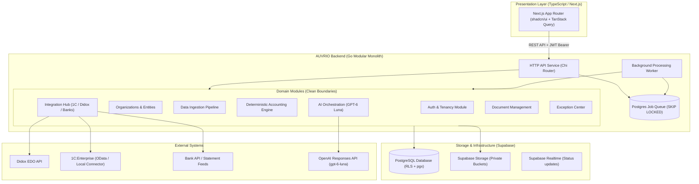
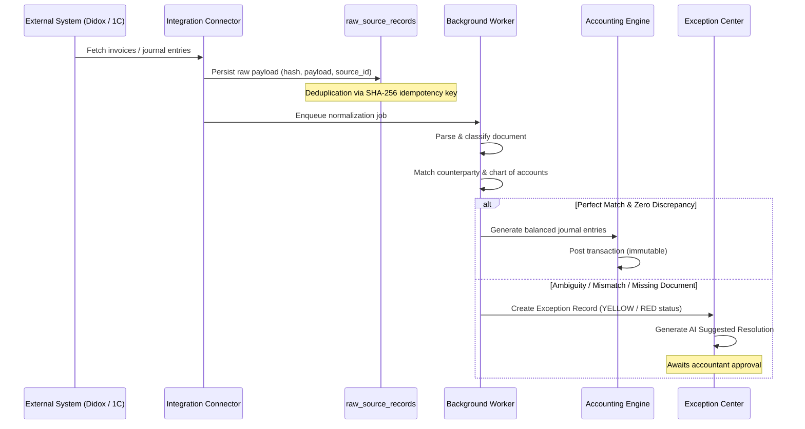

# AUVRIO — System Architecture Blueprint

## 1. High-Level Architectural Vision

AUVRIO is structured as a **Modular Monolith** in Go, serving a modern **Next.js App Router** frontend, backed by **Supabase PostgreSQL** as the persistent relational source of truth.



---

## 2. Monorepo Repository Structure

AUVRIO uses a unified monorepo to guarantee synchronized API contracts, migrations, and shared documentation.

```text
AUVRIO/
├── apps/
│   └── web/                         # Next.js App Router, Tailwind CSS, shadcn/ui
├── services/
│   ├── api/                         # Go HTTP API service
│   │   ├── cmd/api/                 # Main entrypoint for API process
│   │   └── internal/                # Domain modules & business logic
│   ├── worker/                      # Go background jobs and ingestion worker
│   │   ├── cmd/worker/              # Main entrypoint for worker process
│   │   └── internal/                # Job handlers and batch schedulers
│   └── onec-connector/              # Dedicated Go Windows connector daemon for on-prem 1C
├── packages/
│   └── api-contracts/               # OpenAPI spec, generated TypeScript types, Zod schemas
├── supabase/
│   ├── migrations/                  # Versioned SQL migrations (source of truth)
│   └── seed.sql                     # Synthetic seed data for local development
├── docs/
│   ├── architecture/                # Architecture specifications & ADRs
│   │   └── adr/
│   ├── security/                    # Security policies and cryptographic controls
│   └── product/                     # Product requirements and roadmaps
└── scripts/                         # Local development, linting, and build automation
```

---

## 3. Go Backend Design & Module Boundaries

The Go backend adheres to strict dependency injection and interface-based design:

```text
services/api/internal/
├── config/              # Environment parsing and typed app config
├── platform/
│   ├── database/        # pgxpool connection pool lifecycle
│   ├── logger/          # Structured logging (log/slog)
│   ├── middleware/      # Tenant context, auth, CORS, rate-limiting, request ID
│   └── queue/           # Postgres transactional job enqueue helper
└── modules/
    ├── tenancy/         # Workspaces, members, roles, permissions
    ├── entities/        # Business entities (companies, tax configurations)
    ├── ingestion/       # Normalization, deduplication, raw ingestion
    ├── accounting/      # Double-entry ledger, journal entries, trial balance
    ├── integrations/    # Connector interfaces (1C, Didox, Bank adapters)
    ├── ai/              # OpenAI Responses API client, function calling tools
    ├── documents/       # File upload, validation, metadata extraction
    ├── exceptions/      # Discrepancy management and resolution workflows
    └── billing/         # Subscriptions, entitlements, usage metering
```

### Module Boundary Rules:
1. **No Circular Imports**: Modules communicate through exported Go interfaces.
2. **Explicit Context**: Every service method takes `ctx context.Context` as its first parameter for deadline propagation and cancellation.
3. **Database Independence**: Business logic relies on typed repositories generated via `sqlc` with PostgreSQL transactions (`pgx.Tx`).

---

## 4. Frontend Architecture (Next.js App Router)

The frontend is a lightweight, responsive enterprise web application built for business productivity:

- **State Management**: Server state is managed exclusively via **TanStack Query (React Query)** with automatic cache invalidation on mutations.
- **Form Handling & Validation**: React Hook Form coupled with **Zod** schemas matching backend OpenAPI contracts.
- **Design System**: **Tailwind CSS** with **shadcn/ui** primitives, prioritizing dense, readable data tables, clear status badges, and accessibility (WCAG 2.1 AA compliant).
- **Navigation Flow**:
  - Global Workspace Switcher (for accounting firms managing multiple entities).
  - Business Entity Selector with persistent active context.
  - Contextual AI copilot panel accessible across any operational view.

---

## 5. Background Ingestion & Processing Pipeline

Data synchronization from Didox and 1C occurs asynchronously via a resilient multi-stage pipeline:



---

## 6. AI Orchestration Strategy (GPT-6 Luna)

1. **Sole Model**: `gpt-6-luna` accessed via official OpenAI Go SDK using the **Responses API**.
2. **Role & Capability**: Acts as the intelligent workflow coordinator, anomaly detector, and natural-language query parser.
3. **Strict Function Calling**: The model never touches raw SQL. It interacts solely through whitelisted Go tool definitions with structured JSON schemas.
4. **Deterministic Validation Boundary**:
   - AI proposes: `"Match invoice #104 with transaction #882 and debit Account 6010 / credit Account 5110"`.
   - Go Accounting Engine validates: Debits equal Credits, accounts exist in chart of accounts, accounting period is open, user has permission on entity.
   - If validation succeeds and entity policy allows auto-posting, transaction posts; otherwise, it creates a pending proposal in the Exception Center.
