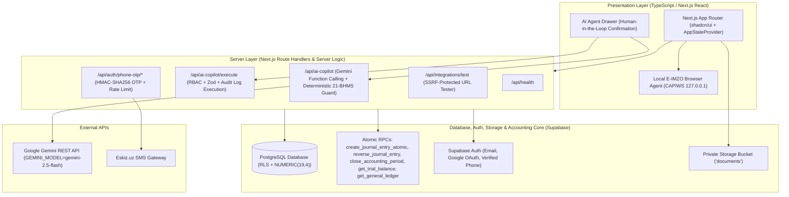

# FIRMUS — System Architecture Blueprint

## 1. High-Level Architectural Vision

FIRMUS is structured as a **Modular Full-Stack TypeScript Application** built on **Next.js App Router**, backed by **Supabase PostgreSQL (Row-Level Security + Atomic PL/pgSQL RPCs)** as the persistent financial source of truth, and orchestrated by a strictly bounded **Gemini AI Agent**.



---

## 2. Repository Structure

```text
firmus/
├── app/
│   ├── (app)/                       # Authenticated SaaS workspace routes
│   ├── (auth)/                      # Login, Register, Forgot Password
│   ├── api/                         # Route Handlers (AI Agent, Execute, OTP, Integration test, Health)
│   ├── auth/callback/               # PKCE OAuth callback with open-redirect guard
│   ├── privacy/ & terms/            # Privacy & Terms compliance pages
├── components/
│   ├── shared/                      # Cookie consent, UI guards
│   ├── shell/                       # Sidebar, Topbar, Footer, Human-in-the-Loop AI Drawer
│   └── ui/                          # shadcn/ui design system primitives
├── lib/
│   ├── ai/                          # FIRMUS Agent engine (firmus-agent.ts) & typed contracts (agent-types.ts)
│   ├── services/                    # supabase-service.ts, eskiz-sms.ts, eimzo-client.ts, bank-import.ts, one-c-export.ts
│   ├── supabase/                    # server.ts, client.ts, service.ts
│   ├── utils/                       # finance.ts (roundMoney, splitVatInclusive, payroll), privacy.ts (PII masking)
│   └── validations/                 # Zod v4 schemas
├── supabase/
│   └── migrations/                  # Versioned SQL migrations (RLS, ledger engine, COA seed, closing, AI audit logs)
├── scripts/                         # Security RLS, accounting hardening, and 31-check production E2E runner
└── tests/unit/                      # Vitest unit tests
```

---

## 3. Core Domain Boundaries

1. **Deterministic Ledger Boundary (`PostgreSQL RPCs`)**: Double-entry balancing (`SUM(debit) = SUM(credit)`), account verification against `chart_of_accounts`, idempotency keys, and immutability triggers execute inside PostgreSQL transactions — UI/LLM logic can never post unbalanced or backdoor-mutated entries.
2. **AI Agent Boundary (`lib/ai/firmus-agent.ts` + `/api/ai-copilot/execute`)**:
   - The LLM interacts strictly via typed Gemini `functionDeclarations` (never raw SQL).
   - PII (`pinfl`, `phone`, `email`, `password`, tokens) is masked via `depersonalizeForAi` before leaving the server.
   - Mutating actions emit typed proposals validated by Zod and live `chart_of_accounts` lookups; execution occurs **only** after the user clicks Approve in the UI and `/api/ai-copilot/execute` verifies RBAC and logs to `ai_action_logs`.
3. **Authentication & Secrets Isolation (`server-only`)**:
   - `SUPABASE_SERVICE_ROLE_KEY`, `GEMINI_API_KEY`, `ESKIZ_EMAIL`, `ESKIZ_PASSWORD`, and `OTP_HMAC_SECRET` remain strictly server-side (`import "server-only"`).
