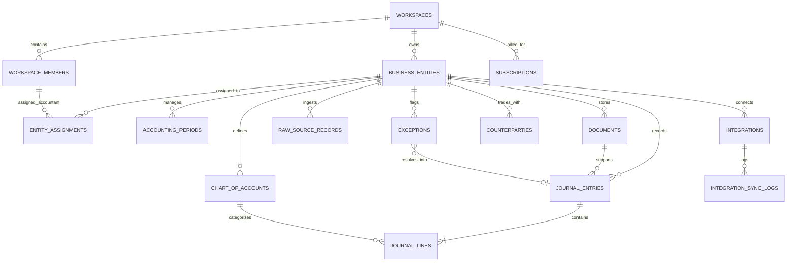

# AUVRIO — Database Design & Schema Specification

## 1. Relational Entity-Relationship Diagram (ERD)



---

## 2. PostgreSQL Tables & Schema Definitions

### 2.1 Multi-Tenancy & Access Control

```sql
-- Workspaces: Billing & Administrative Boundary
CREATE TABLE workspaces (
    id UUID PRIMARY KEY DEFAULT gen_random_uuid(),
    name VARCHAR(255) NOT NULL,
    type VARCHAR(50) NOT NULL CHECK (type IN ('individual_company', 'accounting_firm')),
    owner_user_id UUID NOT NULL REFERENCES auth.users(id) ON DELETE RESTRICT,
    created_at TIMESTAMPTZ NOT NULL DEFAULT clock_timestamp(),
    updated_at TIMESTAMPTZ NOT NULL DEFAULT clock_timestamp()
);

-- Workspace Members: Users participating in a workspace
CREATE TABLE workspace_members (
    id UUID PRIMARY KEY DEFAULT gen_random_uuid(),
    workspace_id UUID NOT NULL REFERENCES workspaces(id) ON DELETE CASCADE,
    user_id UUID NOT NULL REFERENCES auth.users(id) ON DELETE CASCADE,
    role VARCHAR(50) NOT NULL CHECK (role IN (
        'workspace_owner', 'workspace_admin', 'chief_accountant', 
        'accountant', 'auditor', 'company_director', 'viewer'
    )),
    created_at TIMESTAMPTZ NOT NULL DEFAULT clock_timestamp(),
    UNIQUE(workspace_id, user_id)
);

-- Business Entities: Legal companies managed inside a workspace
CREATE TABLE business_entities (
    id UUID PRIMARY KEY DEFAULT gen_random_uuid(),
    workspace_id UUID NOT NULL REFERENCES workspaces(id) ON DELETE CASCADE,
    legal_name VARCHAR(255) NOT NULL,
    trade_name VARCHAR(255),
    tin_stir VARCHAR(20) NOT NULL, -- STIR (Tax ID)
    company_type VARCHAR(50) NOT NULL, -- LLC, Sole Proprietor, etc.
    tax_regime VARCHAR(50) NOT NULL CHECK (tax_regime IN ('turnover_tax', 'vat_profit_tax', 'fixed_tax')),
    currency CHAR(3) NOT NULL DEFAULT 'UZS',
    is_active BOOLEAN NOT NULL DEFAULT true,
    created_at TIMESTAMPTZ NOT NULL DEFAULT clock_timestamp(),
    updated_at TIMESTAMPTZ NOT NULL DEFAULT clock_timestamp(),
    UNIQUE(workspace_id, tin_stir)
);

-- Entity Assignments: Grants specific workspace members access to a client company
CREATE TABLE entity_assignments (
    id UUID PRIMARY KEY DEFAULT gen_random_uuid(),
    business_entity_id UUID NOT NULL REFERENCES business_entities(id) ON DELETE CASCADE,
    workspace_member_id UUID NOT NULL REFERENCES workspace_members(id) ON DELETE CASCADE,
    assigned_role VARCHAR(50) NOT NULL CHECK (assigned_role IN ('lead_accountant', 'assistant_accountant', 'auditor', 'director')),
    created_at TIMESTAMPTZ NOT NULL DEFAULT clock_timestamp(),
    UNIQUE(business_entity_id, workspace_member_id)
);
```

---

### 2.2 Deterministic Double-Entry Accounting Engine

> **Critical Rule:** Financial calculations must never use floating-point types (`REAL` or `DOUBLE PRECISION`). All money amounts use `NUMERIC(19, 4)` for exact sub-unit precision.

```sql
-- Chart of Accounts: National Standard Chart of Accounts (NSCA Uzbekistan)
CREATE TABLE chart_of_accounts (
    id UUID PRIMARY KEY DEFAULT gen_random_uuid(),
    business_entity_id UUID NOT NULL REFERENCES business_entities(id) ON DELETE CASCADE,
    code VARCHAR(20) NOT NULL, -- e.g., '5110' (Raschetnyy schet), '6010' (Postavshchiki)
    name VARCHAR(255) NOT NULL,
    type VARCHAR(50) NOT NULL CHECK (type IN ('asset', 'liability', 'equity', 'revenue', 'expense')),
    is_active BOOLEAN NOT NULL DEFAULT true,
    parent_id UUID REFERENCES chart_of_accounts(id) ON DELETE RESTRICT,
    created_at TIMESTAMPTZ NOT NULL DEFAULT clock_timestamp(),
    UNIQUE(business_entity_id, code)
);

-- Accounting Periods
CREATE TABLE accounting_periods (
    id UUID PRIMARY KEY DEFAULT gen_random_uuid(),
    business_entity_id UUID NOT NULL REFERENCES business_entities(id) ON DELETE CASCADE,
    name VARCHAR(50) NOT NULL, -- e.g., '2026-Q1'
    start_date DATE NOT NULL,
    end_date DATE NOT NULL,
    is_closed BOOLEAN NOT NULL DEFAULT false,
    closed_at TIMESTAMPTZ,
    closed_by_user_id UUID REFERENCES auth.users(id),
    UNIQUE(business_entity_id, name)
);

-- Journal Entries: Header for financial transactions (Immutable once posted)
CREATE TABLE journal_entries (
    id UUID PRIMARY KEY DEFAULT gen_random_uuid(),
    business_entity_id UUID NOT NULL REFERENCES business_entities(id) ON DELETE RESTRICT,
    entry_number VARCHAR(50) NOT NULL,
    entry_date DATE NOT NULL,
    status VARCHAR(20) NOT NULL DEFAULT 'draft' CHECK (status IN ('draft', 'posted', 'reversed')),
    description TEXT NOT NULL,
    source_type VARCHAR(50) NOT NULL, -- 'manual', 'didox_invoice', 'bank_statement', '1c_sync'
    source_reference_id VARCHAR(100),
    posted_at TIMESTAMPTZ,
    posted_by_user_id UUID REFERENCES auth.users(id),
    created_at TIMESTAMPTZ NOT NULL DEFAULT clock_timestamp(),
    UNIQUE(business_entity_id, entry_number)
);

-- Journal Lines: Individual debits and credits
CREATE TABLE journal_lines (
    id UUID PRIMARY KEY DEFAULT gen_random_uuid(),
    journal_entry_id UUID NOT NULL REFERENCES journal_entries(id) ON DELETE CASCADE,
    account_id UUID NOT NULL REFERENCES chart_of_accounts(id) ON DELETE RESTRICT,
    debit_amount NUMERIC(19, 4) NOT NULL DEFAULT 0.0000 CHECK (debit_amount >= 0),
    credit_amount NUMERIC(19, 4) NOT NULL DEFAULT 0.0000 CHECK (credit_amount >= 0),
    counterparty_id UUID,
    memo TEXT,
    created_at TIMESTAMPTZ NOT NULL DEFAULT clock_timestamp(),
    -- Enforce single-side entry per line: either debit > 0 or credit > 0, never both
    CONSTRAINT chk_debit_or_credit CHECK (
        (debit_amount > 0 AND credit_amount = 0) OR
        (credit_amount > 0 AND debit_amount = 0)
    )
);
```

---

### 2.3 Integrations & Raw Ingestion

```sql
-- Connected Integrations per Business Entity
CREATE TABLE integrations (
    id UUID PRIMARY KEY DEFAULT gen_random_uuid(),
    business_entity_id UUID NOT NULL REFERENCES business_entities(id) ON DELETE CASCADE,
    provider VARCHAR(50) NOT NULL CHECK (provider IN ('1c_enterprise', 'didox', 'bank_api', 'custom_csv')),
    status VARCHAR(50) NOT NULL DEFAULT 'inactive' CHECK (status IN ('active', 'inactive', 'error', 'syncing')),
    encrypted_credentials JSONB NOT NULL, -- AES-256-GCM encrypted tokens & keys
    settings JSONB NOT NULL DEFAULT '{}'::jsonb,
    last_synced_at TIMESTAMPTZ,
    sync_cursor VARCHAR(255),
    error_message TEXT,
    created_at TIMESTAMPTZ NOT NULL DEFAULT clock_timestamp(),
    updated_at TIMESTAMPTZ NOT NULL DEFAULT clock_timestamp(),
    UNIQUE(business_entity_id, provider)
);

-- Raw Source Records: Ingested payloads stored for auditability & idempotency
CREATE TABLE raw_source_records (
    id UUID PRIMARY KEY DEFAULT gen_random_uuid(),
    business_entity_id UUID NOT NULL REFERENCES business_entities(id) ON DELETE CASCADE,
    source_system VARCHAR(50) NOT NULL,
    external_record_id VARCHAR(255) NOT NULL,
    payload_hash VARCHAR(64) NOT NULL, -- SHA-256 for duplicate detection
    raw_payload JSONB NOT NULL,
    ingestion_status VARCHAR(50) NOT NULL DEFAULT 'pending' CHECK (ingestion_status IN ('pending', 'processed', 'duplicate', 'failed')),
    created_at TIMESTAMPTZ NOT NULL DEFAULT clock_timestamp(),
    UNIQUE(business_entity_id, source_system, external_record_id)
);
```

---

### 2.4 Exception Center & Human-in-the-Loop Management

```sql
-- Exceptions: Flags detected anomalies, unmatched transactions, or parsing ambiguities
CREATE TABLE exceptions (
    id UUID PRIMARY KEY DEFAULT gen_random_uuid(),
    business_entity_id UUID NOT NULL REFERENCES business_entities(id) ON DELETE CASCADE,
    severity VARCHAR(20) NOT NULL CHECK (severity IN ('info', 'warning', 'critical')),
    status VARCHAR(20) NOT NULL DEFAULT 'open' CHECK (status IN ('open', 'resolved', 'ignored')),
    category VARCHAR(50) NOT NULL, -- 'unmatched_payment', 'unknown_counterparty', 'tax_discrepancy'
    title VARCHAR(255) NOT NULL,
    description TEXT NOT NULL,
    evidence_payload JSONB NOT NULL,
    ai_suggested_resolution TEXT,
    ai_confidence_score NUMERIC(5, 2), -- e.g., 95.50%
    resolved_by_user_id UUID REFERENCES auth.users(id),
    resolved_at TIMESTAMPTZ,
    created_at TIMESTAMPTZ NOT NULL DEFAULT clock_timestamp()
);
```
