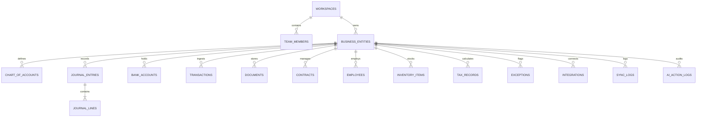

# FIRMUS — Database Design & Schema Specification

## 1. Relational Entity-Relationship Overview

FIRMUS runs on Supabase PostgreSQL with Row-Level Security (RLS) across all multi-tenant tables, exact `NUMERIC(19, 4)` accounting precision, atomic ledger RPCs, and append-only audit logs.

---

## 2. Implemented Schema Highlights

### 2.1 Multi-Tenancy, Auth & Phone Verification
- `workspaces`: Workspace ownership (`owner_user_id`), type (`individual_company`, `accounting_firm`), and plan metadata.
- `team_members`: Workspace role (`workspace_owner`, `workspace_admin`, `chief_accountant`, `accountant`, `auditor`, `company_director`, `viewer`), active status, per-entity assignments (`assigned_entity_ids`), verified phone metadata (`phone`, `phone_verified_at`).
- `business_entities`: Legal entity details, 9-digit `tin_stir`, tax regime (`turnover_tax`, `vat_profit_tax`, `fixed_tax`), currency (`UZS`). Automatic `handle_new_business_entity` trigger seeds the 21-son BHMS Chart of Accounts on insert.
- `phone_otp_verifications`: Service-role-only table storing HMAC-SHA256 OTP hashes, expiry, cooldown, and attempt counters (`max 5`) for Eskiz.uz SMS verification.

### 2.2 Deterministic Double-Entry Accounting Engine
- `chart_of_accounts`: Active 21-BHMS accounts per `business_entity_id` (`0100`, `0200`, `1010`, `2910`, `4010`, `4410`, `4510`, `5010`, `5110`, `5210`, `6010`, `6310`, `6410`, `6520`, `6710`, `8330`, `8710`, `9010`, `9020`, `9030`, `9110`, `9120`, `9410`, `9420`, `9430`, `9910`).
- `journal_entries` & `journal_lines`: `NUMERIC(19, 4)` debit/credit amounts, single-side line enforcement, `UNIQUE(business_entity_id, idempotency_key)`, and immutability triggers (`trg_journal_entry_immutable`, `trg_journal_lines_immutable`).
- **Atomic RPCs**: `create_journal_entry_atomic`, `reverse_journal_entry`, `close_accounting_period`, `get_trial_balance`, `get_general_ledger`.

### 2.3 Operations, Storage & AI Auditability
- Operational tables: `bank_accounts`, `transactions`, `documents` (with `file_url`, `file_name`, `file_size` backed by private `'documents'` Storage bucket), `contracts`, `employees`, `inventory_items`, `tax_records`, `tax_deadlines`, `exceptions`, `integrations`, `sync_logs`.
- `ai_action_logs`: Append-only RLS-protected audit log capturing every Human-in-the-Loop AI decision (`approved`, `rejected`, `failed`), payload, actor user, and model used.
