# AUVRIO — Implementation Roadmap

This roadmap structures the delivery of AUVRIO into disciplined, verifiable phases. Work advances only when the prerequisites and verification tests of the preceding phase are validated.

```mermaid
flowchart LR
    P0["Phase 0: Discovery & Architecture"] --> P1["Phase 1: Platform Foundation"]
    P1 --> P2["Phase 2: Business Workspace"]
    P2 --> P3["Phase 3: Integration Framework"]
    P3 --> P4["Phase 4: Accounting Engine"]
    P4 --> P5["Phase 5: AI Orchestration (GPT-6 Luna)"]
    P5 --> P6["Phase 6: Live 1C & Didox Integrations"]
    P6 --> P7["Phase 7: Tax & Financial Statements"]
    P7 --> P8["Phase 8: Billing, Security Audit & Launch"]
```

---

## Phase 0: Discovery, System Architecture & Design
- **Deliverables**:
  - `PROJECT_BRIEF.md`, `ARCHITECTURE.md`, `DATABASE_DESIGN.md`, `SECURITY.md`, `ROADMAP.md`
  - Architectural Decision Records (`ADR-0001` to `ADR-0004`)
  - Initial repository layout and environment definitions
- **Verification Criteria**:
  - Architecture blueprint approved by project stakeholders
  - Tech stack strictly adheres to constraints (Go Modular Monolith, Next.js, Supabase, `gpt-6-luna`)

---

## Phase 1: Platform Foundation & Core Multi-Tenancy
- **Deliverables**:
  - Supabase database initialization with migrations for `workspaces`, `workspace_members`, `business_entities`, `entity_assignments`.
  - Go API service baseline with Chi router, health check, structured logging (`log/slog`), and JWT auth middleware.
  - Next.js Web App baseline with Tailwind CSS, shadcn/ui, TanStack Query, and Auth flow (Sign Up, Sign In).
- **Verification Criteria**:
  - User can register, create an individual company workspace or an accounting firm workspace.
  - Adding members and assigning roles enforces backend permission boundaries.
  - Automated tests pass for tenant isolation (users cannot access foreign workspace data).

---

## Phase 2: Business Workspace & Entity Management
- **Deliverables**:
  - Multi-company switcher UI for accounting practices.
  - Business entity configuration: Legal name, STIR (TIN), tax regime selection (`turnover_tax`, `vat_profit_tax`), currency.
  - Audit logging middleware and event capture.
- **Verification Criteria**:
  - Accounting firm accountant can view only assigned client companies.
  - Switcher updates global entity context without page reloads.

---

## Phase 3: Integration Framework & Mock Connectors
- **Deliverables**:
  - Interface-based connector architecture (`Connector`, `Authenticator`, `Syncer`).
  - Secure credential storage service with AES-256-GCM envelope encryption.
  - Mock connectors for 1C (OData simulator) and Didox (invoicing simulator).
  - Background ingestion worker with PostgreSQL transactional queue.
- **Verification Criteria**:
  - Raw source records ingest idempotently with SHA-256 duplicate detection.
  - Integration credential secrets never leak into logs or API responses.

---

## Phase 4: Deterministic Accounting Engine
- **Deliverables**:
  - National Standard Chart of Accounts (NSCA) of Uzbekistan initialization.
  - Double-entry ledger logic in pure Go: Debit/Credit balancing enforcement.
  - Journal entry creation, draft status, and posting workflow.
  - Real-time Trial Balance and General Ledger calculation.
- **Verification Criteria**:
  - Automated test verifying exact decimal calculations using `NUMERIC(19, 4)` (no floating point errors).
  - Unbalanced journal entries are rejected by both Go service and DB constraints.
  - Posted entries cannot be edited in place (immutability test).

---

## Phase 5: AI Orchestration & Exception Center
- **Deliverables**:
  - OpenAI Go SDK client configured exclusively for `gpt-6-luna`.
  - Typed Tool Calling / Function Calling schemas for accounting actions.
  - Human-in-the-loop Exception Center: Traffic light status system (Green/Yellow/Red).
  - Natural-language query interface for financial and compliance inquiries.
- **Verification Criteria**:
  - AI function calls pass entity authorization checks before execution.
  - Zero raw SQL executed by AI.
  - High confidence matches post automatically (if entity policy allows); anomalies route to Exception Center.

---

## Phase 6: Live Integrations (Didox & 1C:Enterprise)
- **Deliverables**:
  - Official Didox Partner API integration (sandbox & production readiness).
  - Client-side E-IMZO browser integration for digital signature generation.
  - 1C OData REST connector and standalone Windows Connector daemon.
  - Bidirectional reconciliation between bank statements, Didox invoices, and 1C entries.
- **Verification Criteria**:
  - Electronic invoices successfully pull from Didox sandbox into raw records.
  - 1C chart of accounts and counterparties synchronize without schema errors.

---

## Phase 7: Tax, Financial Reporting & Advanced Modules
- **Deliverables**:
  - Balance Sheet (Form No. 1) and Profit & Loss Statement (Form No. 2) generators.
  - Turnover Tax and VAT computation helpers for Uzbekistan tax regimes.
  - Document management with private Supabase Storage buckets and temporary signed URLs.
- **Verification Criteria**:
  - Financial reports match trial balance totals with 100% precision.
  - Storage bucket policies block unauthorized cross-entity file access.

---

## Phase 8: Billing, Security Audit & Production Launch
- **Deliverables**:
  - Multi-tier subscription model and entitlement enforcement.
  - Local payment provider webhooks (Click, Payme, Uzum) with idempotency keys.
  - Security review, load testing, and rate limiting validation.
  - Production deployment documentation and automated CI/CD pipelines.
- **Verification Criteria**:
  - Payment webhooks process idempotently without double-crediting.
  - Penetration testing confirms tenant isolation and zero credential leakage.
