# FIRMUS — Implementation Roadmap (Next.js + Supabase Edition)

> **Architecture Note**: The project consolidated from an early Go microservice draft into a unified **Next.js App Router (TypeScript) + Supabase PostgreSQL (RLS & PL/pgSQL RPCs) + Gemini AI Function Calling** platform for faster iteration, unified Zod contracts, and single-deployment simplicity.

```mermaid
flowchart LR
    P0["Phase 0: Architecture [DONE]"] --> P1["Phase 1: Security & RLS [DONE]"]
    P1 --> P2["Phase 2: Workspace & Entities [DONE]"]
    P2 --> P3["Phase 3: Ingestion & 1C/Bank [DONE]"]
    P3 --> P4["Phase 4: Atomic Ledger [DONE]"]
    P4 --> P5["Phase 5: Gemini AI Agent [DONE]"]
    P5 --> P6["Phase 6: E-IMZO & Documents [READY / SANDBOX]"]
    P6 --> P7["Phase 7: Tax, Closing & Reports [DONE]"]
    P7 --> P8["Phase 8: SMS OTP, CI & Hardening [LIVE LOCAL / PRE-PROD]"]
```

---

## Phase 0: Discovery, System Architecture & Design — [DONE]
- **Deliverables**:
  - `PROJECT_BRIEF.md`, `ARCHITECTURE.md`, `DATABASE_DESIGN.md`, `SECURITY.md`, `ROADMAP.md`
  - Architectural Decision Records (`ADR-0001` to `ADR-0004`)
  - Next.js App Router + TypeScript + Tailwind CSS + shadcn/ui + Supabase baseline

## Phase 1: Security Foundation & Multi-Tenancy — [DONE]
- **Deliverables**:
  - Supabase migrations for `workspaces`, `team_members`, `business_entities` with strict RLS helper functions (`get_auth_user_workspaces`, `get_auth_user_entities`, `get_auth_user_role`).
  - Email/Password Auth, Google OAuth PKCE callback with open-redirect guard, and Eskiz.uz SMS OTP phone verification.
  - Automated RLS isolation test suite (`scripts/test-security-rls.mjs`).

## Phase 2: Business Workspace & Entity Management — [DONE]
- **Deliverables**:
  - Multi-company switcher & workspace creation (`create_workspace_with_owner`).
  - Entity configuration: Legal name, STIR, tax regime (`turnover_tax`, `vat_profit_tax`, `fixed_tax`), currency, automatic 21-BHMS COA seeding.
  - Team RBAC (`workspace_owner`, `workspace_admin`, `chief_accountant`, `accountant`, `company_director`, `auditor`, `viewer`) and entity assignment matrix.

## Phase 3: Bank Ingestion & 1C Exchange — [DONE]
- **Deliverables**:
  - Client-side & server-validated parsers for 1C Client-Bank `.txt` and bank `.csv` statements (`lib/services/bank-import.ts`).
  - 1C Client-Bank & Enterprise XML exporters (`lib/services/one-c-export.ts`).
  - SSRF-protected integration URL verification (`/api/integrations/test`) and sync logs.

## Phase 4: Deterministic Accounting Engine (21-BHMS) — [DONE]
- **Deliverables**:
  - Atomic PL/pgSQL ledger RPCs (`create_journal_entry_atomic`, `reverse_journal_entry`, `get_trial_balance`, `get_general_ledger`).
  - `NUMERIC(19, 4)` arithmetic, idempotency key deduplication, immutability triggers (`trg_journal_entry_immutable`, `trg_journal_lines_immutable`).
  - Hardening suites verified (`scripts/test-accounting-engine.mjs`, `scripts/test-accounting-hardening.mjs`).

## Phase 5: Strict FIRMUS AI Agent (Gemini + Human-in-the-Loop) — [DONE]
- **Deliverables**:
  - `lib/ai/firmus-agent.ts` with comprehensive 21-BHMS + Tax Code system instructions and live active COA injection.
  - Configurable `GEMINI_MODEL` (free-tier default `gemini-3.8-flash` + fallback `gemini-3.5-flash-lite`) + offline deterministic guard (`deterministic_guard`) + conversation memory (`history`).
  - 13 typed tools (5 read-only tools + 8 schema-validated Human-in-the-Loop `propose_*` tools).
  - Dedicated `/api/ai-copilot/execute` endpoint with RBAC checks, Zod re-validation, atomic ledger execution, and immutable `ai_action_logs`.

## Phase 6: Document Management, E-IMZO & External Gateways — [CORE DONE / PARTNER KEYS PENDING]
- **Delivered**:
  - Private Supabase `documents` Storage bucket with RLS policies, binary upload, and signed URL download.
  - Local browser E-IMZO (`CAPIWS` `127.0.0.1:64443`/`64646`) certificate listing and local PKCS#7 signing.
  - Automatic 3-line 12% VAT split journal entry on invoice signing.
- **Pending Partner Credentials (External Business Agreements)**:
  - Live commercial Didox Partner API / MySolik production tokens when moving beyond sandbox/local files.

## Phase 7: Tax, Payroll, Period Closing & Financial Statements — [DONE]
- **Deliverables**:
  - Atomic month/period closing RPC (`close_accounting_period`: closes `90xx`/`91xx`/`94xx` through `9910` to `8710`).
  - Balance Sheet & Profit/Loss statements without double-counting closed periods (`app/(app)/finance/page.tsx`).
  - Payroll tax helpers (12% JShODS, 12% social tax) with PINFL masking and HR/Contracts/Inventory CRUD.

## Phase 8: SMS OTP, Legal Compliance, CI & Production Readiness — [CORE DONE / LIVE ENV PENDING]
- **Delivered**:
  - Eskiz.uz server OTP flow (`phone_otp_verifications`, HMAC-SHA256 OTP hash, 60s cooldown, max 5 attempts).
  - `/privacy`, `/terms`, Cookie Consent banner, Vitest unit tests, ESLint, GitHub Actions CI, `pnpm audit --prod` 0 vulnerabilities, and `scripts/test-full-production.mjs`.
- **Optional / Pre-Production Activation Items**:
  - Populate `.env.local` with commercial/free keys (`GEMINI_API_KEY`, `ESKIZ_EMAIL`, `ESKIZ_PASSWORD`, `ESKIZ_FROM`) and optional Click/Payme/Uzum merchant webhook credentials when live payment billing is activated.
