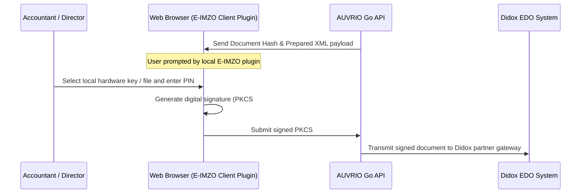

# AUVRIO — Security Architecture & Data Protection

## 1. Core Security Principles

AUVRIO processes sensitive financial records, tax declarations, and enterprise transaction ledgers. Security is implemented with defense-in-depth across the application runtime, database, network, and cryptographic boundaries.

---

## 2. Zero-Trust Digital Signature (E-IMZO) Architecture

> **Absolute Rule**: E-IMZO digital signature (.pfx/.key) private keys and passwords **MUST NEVER** be uploaded, stored, or transmitted to AUVRIO servers under any circumstances.

1. **Client-Side Signing**: Document payloads are prepared and hashed on the Go backend. The raw hash is delivered to the frontend, where the official local E-IMZO browser module signs it using the user's local key.
2. **Server-Side Verification**: The backend verifies the signature certificate metadata and validity via public verification APIs without ever accessing the private key.

---

## 3. Integration Credential Encryption

Credentials for 1C endpoints, Didox partner sessions, and bank APIs are encrypted at rest using **AES-256-GCM** authenticated encryption:

- **Key Management**: Master encryption keys are supplied via environment variables (`AUVRIO_INTEGRATION_KEY`) and never committed to source code.
- **Envelope Encryption**: Each business entity's credential payload is encrypted with a unique initialization vector (IV/nonce) and authentication tag to prevent ciphertext tampering.
- **Redaction**: Integration credentials and tokens are strictly stripped from all log outputs, error payloads, and frontend API responses.

---

## 4. Multi-Tenant Data Isolation (Dual-Layer Defense)

AUVRIO enforces data isolation at both the application layer and database layer:

### Layer 1: Go Application Context & Middleware
1. Every incoming HTTP request passes through `TenantContextMiddleware`.
2. The user's JWT is validated against Supabase Auth public keys.
3. The user's active `workspace_id` and targeted `business_entity_id` are extracted.
4. Database queries verify that the user possesses an active `workspace_member` record and (for client companies in accounting firms) a valid `entity_assignment`.
5. Missing or mismatched permissions immediately terminate the request with `403 Forbidden` prior to executing business queries.

### Layer 2: PostgreSQL Row-Level Security (RLS)
Tables in exposed schemas enforce Row-Level Security policies ensuring that even if a direct query were executed, rows from other workspaces are invisible.

---

## 5. Audit Logging & Immutable Ledger

- **Immutability of Financial Records**: Once a `journal_entry` is marked `posted`, database update triggers prevent in-place modifications to amounts, accounts, or dates. Any modification requires a compensating `reversal` entry.
- **Audit Trails**: Every administrative action, integration sync, permission change, and AI-suggested transaction approval is recorded in an append-only `audit_logs` table containing:
  - Timestamp (`clock_timestamp()`)
  - Acting User ID
  - Business Entity ID
  - Action Category & Description
  - Before/After JSON diff
  - Client IP & User Agent

---

## 6. Uzbekistan Data Protection Compliance (ZRU-547)

- **Data Residency**: Prior to moving to production, customer databases containing identifiable personal data of citizens of the Republic of Uzbekistan must be hosted on servers physically situated within Uzbekistan territory, complying with Law No. ZRU-547.
- **Anonymization in Development**: The Supabase Free tier and local development environments use purely synthetic, anonymized seed records. Real customer financial data is prohibited in development environments.
